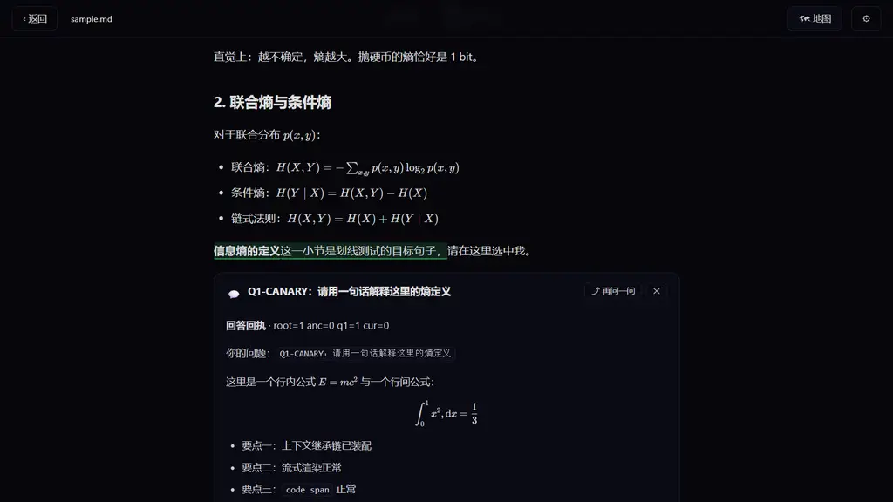
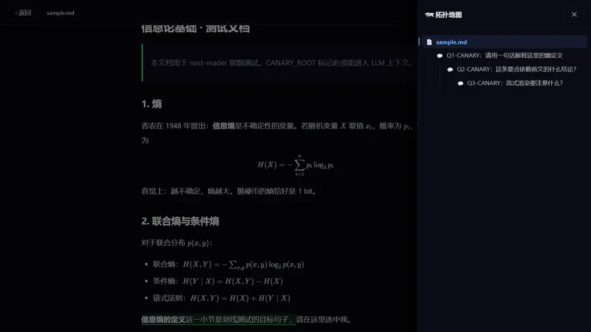

# TRead

Markdown + LaTeX 精读阅读器。在任何有疑问的地方**划线提问**，AI 的回答就地呈现；
每个提问都能**「再问一问」展开成全屏子页面**，页内可以继续划线提问——问题生问题，
形成一棵拓扑树。顶栏「地图」随时查看整棵树，点击任意节点跳转。




提问时自动携带**完整上下文链**：根文档 + 沿途所有祖先问答 + 当前页，
嵌套再深，回答也精确。

## 快速开始

浏览器不允许 `file://` 直接跑 ES 模块，先起一个静态服务：

```bash
cd TRead
python -m http.server 8800        # 任意静态服务器都行
```

打开 `http://127.0.0.1:8800`：

1. 首次进入会弹出**设置**：填 OpenAI 兼容端点的 Base URL / API Key / Model
   （如 DeepSeek、GLM、通义等，Base URL 带 `/v1`）。
2. 点「📂 打开文件」选一个 `.md` / `.txt`。
3. 选中一段文字 → 点「💬 提问」，输入问题，回答就地流式生成。
4. 点回答卡上的「⤴ 再问一问」（或划线菜单里直接点）→ 全屏子页面；
   在回答里继续选中、提问，无限嵌套。
5. 顶栏「🗺 地图」看拓扑树：悬停看完整提问标题，点击跳转，左上角「‹ 返回」逐级回退。

## 特性

- **渲染**：markdown-it + KaTeX（`$...$` / `$$...$$`）+ 代码高亮
- **上下文继承**：组装 messages 时沿父链收集「根文档 + 祖先问答 + 当前页」；
  超过预算（默认 12 万字，可在设置里改）时从最远的祖先开始截断
- **划线持久化**：按「前文 + 选中原文 + 后文」三元组重新定位，刷新后划线仍在
- **数据自带**：全部存本机 localStorage；设置页可导出 / 导入 JSON（导出不含 API Key）
- **界面**：暗色，GSAP 动效（选区菜单、地图抽屉、全屏展开转场）

## 限制（v1）

- 公式与代码块内部不可划线（选中整段没问题）
- 同一段文字在文中完全重复且前后文也相同时，划线可能定位到第一处
- 需要端点允许浏览器跨域（CORS）；不允许时请换端点或自加代理

## 目录结构

```
TRead/
├── index.html          页面骨架
├── vendor/             本地依赖（markdown-it / KaTeX / highlight.js / GSAP），无构建
└── src/
    ├── app.js          启动、导航、视图切换与转场
    ├── store.js        树模型、持久化、上下文组装（buildParts）
    ├── render.js       markdown + KaTeX + 高亮管线
    ├── annotate.js     划线、锚定、浮动菜单、问答卡片
    ├── ask.js          流式问答生命周期（订阅 / 重试）
    ├── ai.js           OpenAI 兼容 SSE 客户端
    ├── mapdrawer.js    拓扑地图抽屉
    └── settings.js     设置面板、导入导出、文件选择
```

设计文档见 [DESIGN.md](DESIGN.md)。
